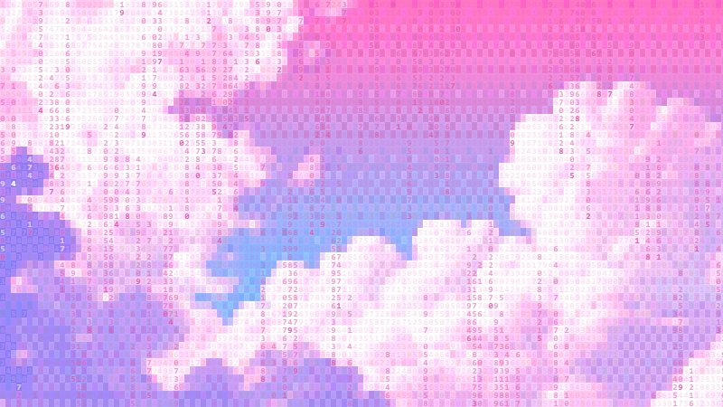

<p align="center">
  
</p>

<p align="center">
  An animated cloudscape drawn with characters, with characters falling through it like rain.<br />
  Tune it in the browser, then take it anywhere: embed, HTML, React, JS, video or GIF.
</p>

<p align="center">
  <a href="https://vercel.com/new/clone?repository-url=https://github.com/GitNimay/Cloud-Rain-Shaders"></a>
</p>

<br />

## Shaders

| Shader | Description | Source |
| :-- | :-- | :-- |
| **Cloud Rain** | A dithered sky of digits with Matrix-style rain falling through it | [`cloud-rain.js`](public/ascii-shedders/cloud-rain.js) |

## Themes

<table>
  <tr>
    <td width="33%"></td>
    <td width="33%"></td>
    <td width="33%"></td>
  </tr>
  <tr>
    <td align="center"><b>Original</b><br /><sub>Cobalt sky, white cumulus</sub></td>
    <td align="center"><b>Evening</b><br /><sub>Indigo to sunset orange</sub></td>
    <td align="center"><b>Autumn</b><br /><sub>Teal sky, amber clouds</sub></td>
  </tr>
  <tr>
    <td width="33%"></td>
    <td width="33%"></td>
    <td width="33%"></td>
  </tr>
  <tr>
    <td align="center"><b>Candy</b><br /><sub>Pink, lavender, baby blue</sub></td>
    <td align="center"><b>Midnight</b><br /><sub>Navy sky, moonlit clouds</sub></td>
    <td></td>
  </tr>
</table>

## Parameters

| Parameter | Options | Default |
| :-- | :-- | :-- |
| `effect` | `original` `evening` `autumn` `candy` `midnight` | `original` |
| `glyphs` | `digits` `binary` `hex` `symbols` | `digits` |
| `cell` | 4 – 16 px | 4 |
| `speed` | 1 – 30 cells/s | 6 |
| `density` | 0 – 1 | 0.8 |
| `trail` | 2 – 40 cells | 18 |
| `contrast` | 0.6 – 1.8 | 1.14 |

## Use it

**Embed**: any page, any site.

```html
<iframe src="https://<your-site>/ascii-shedders/cloud-rain.html?effect=candy&cell=8"
  style="width: 100%; aspect-ratio: 16 / 9; border: 0"></iframe>
```

**JavaScript**: one dependency-free module.

```js
import { mount } from './cloud-rain.js'

const shader = mount(document.querySelector('canvas'), { effect: 'evening', cell: 8 })
shader.update({ speed: 12 }) // change settings live
shader.destroy()             // stop and clean up
```

The editor's **Export** panel generates these with your settings, plus a React component, a self-contained HTML file, a video and a GIF.

## Run locally

```bash
pnpm install
pnpm dev
```

<br />

<p align="center">
  <sub>
    Built with TanStack Router, React, Vite, Tailwind CSS and Radix.
    Sheen pill button adapted from <a href="https://opensourceui.in/components/sheen-pill-button">Open Source UI</a> (MIT) · icons from <a href="https://lucide.dev">Lucide</a> (ISC).
  </sub>
</p>
