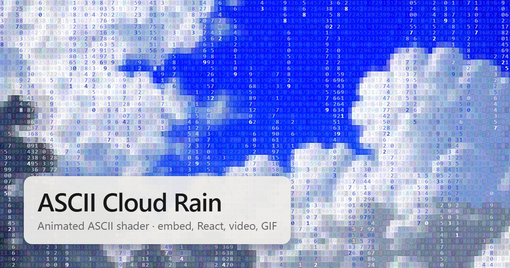
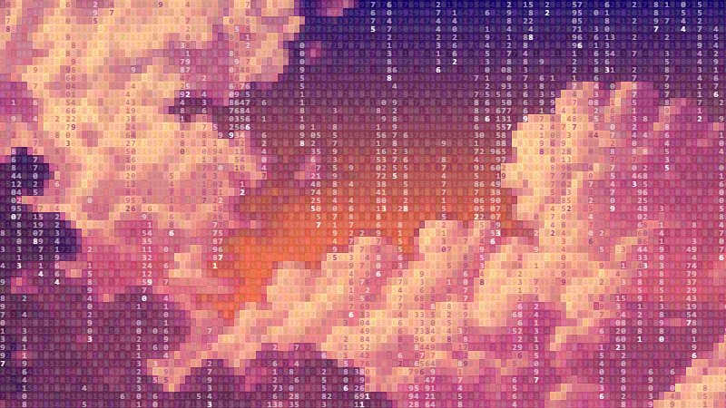

<p align="center">
  
</p>

<p align="center">
  An animated cloudscape drawn with characters, with characters falling through it like rain.<br />
  Tune it in the browser, then take it anywhere: embed, HTML, React, JS, video or GIF.
</p>

<p align="center">
  <a href="https://vercel.com/new/clone?repository-url=https://github.com/GitNimay/Cloud-Rain-Shaders"></a>
</p>

<br />

## Shaders

| Shader | Description | Source |
| :-- | :-- | :-- |
| **Cloud Rain** | A dithered sky of digits with Matrix-style rain falling through it | [`cloud-rain.js`](public/ascii-shedders/cloud-rain.js) |

## Themes

<table>
  <tr>
    <td width="33%"></td>
    <td width="33%"></td>
    <td width="33%"></td>
  </tr>
  <tr>
    <td align="center"><b>Original</b><br /><sub>Cobalt sky, white cumulus</sub></td>
    <td align="center"><b>Evening</b><br /><sub>Indigo to sunset orange</sub></td>
    <td align="center"><b>Autumn</b><br /><sub>Teal sky, amber clouds</sub></td>
  </tr>
  <tr>
    <td width="33%"></td>
    <td width="33%"></td>
    <td width="33%"></td>
  </tr>
  <tr>
    <td align="center"><b>Candy</b><br /><sub>Pink, lavender, baby blue</sub></td>
    <td align="center"><b>Midnight</b><br /><sub>Navy sky, moonlit clouds</sub></td>
    <td></td>
  </tr>
</table>

## Parameters

| Parameter | Options | Default |
| :-- | :-- | :-- |
| `effect` | `original` `evening` `autumn` `candy` `midnight` | `original` |
| `glyphs` | `digits` `binary` `hex` `symbols` | `digits` |
| `cell` | 4 – 16 px | 4 |
| `speed` | 1 – 30 cells/s | 6 |
| `density` | 0 – 1 | 0.8 |
| `trail` | 2 – 40 cells | 18 |
| `contrast` | 0.6 – 1.8 | 1.14 |

## Use it

**Embed**: any page, any site.

```html
<iframe src="https://<your-site>/ascii-shedders/cloud-rain.html?effect=candy&cell=8"
  style="width: 100%; aspect-ratio: 16 / 9; border: 0"></iframe>
```

**JavaScript**: one dependency-free module.

```js
import { mount } from './cloud-rain.js'

const shader = mount(document.querySelector('canvas'), { effect: 'evening', cell: 8 })
shader.update({ speed: 12 }) // change settings live
shader.destroy()             // stop and clean up
```

**Render it yourself**: a fixed pixel size and your own clock, for video or tests.

```js
const shader = mount(canvas, { effect: 'candy', width: 1920, height: 1080, pixelRatio: 2, autoplay: false })
await shader.ready
shader.render(1 / 60) // advance one 60th of a second and draw
```

## Export

The editor's **Export** panel turns the look on screen into something you can take away. Every export states all seven settings, so what you tuned is exactly what you get.

| Export | What you get |
| :-- | :-- |
| **Embed** | An `<iframe>` whose URL carries every setting |
| **HTML** | One self-contained file with the renderer and your settings inside |
| **React** | A component with your settings built in; props override them |
| **JS** | A `mount()` call with your settings |
| **Video** | 720p to 4K at 60 fps, 5 to 20 s |
| **GIF** | 640 × 360 at 20 fps |

Video and GIF are not screen recordings. A second copy of the shader is rendered off-screen at the output's own resolution, one frame at a time, so every frame is there and sharp however slow the device is. The frame is as many cells wide as your preview, so it looks like what you see.

Video is encoded in the browser with WebCodecs: H.264 in MP4 on a hardware encoder where there is one, otherwise VP9 or AV1 in WebM at constant quality. If the device cannot encode the size you picked, the next size down is used and the file name says which.

## Run locally

```bash
pnpm install
pnpm dev
```

<br />

<p align="center">
  <sub>
    Built with TanStack Router, React, Vite, Tailwind CSS and Radix.
    Sheen pill button adapted from <a href="https://opensourceui.in/components/sheen-pill-button">Open Source UI</a> (MIT) · icons from <a href="https://lucide.dev">Lucide</a> (ISC).
  </sub>
</p>
